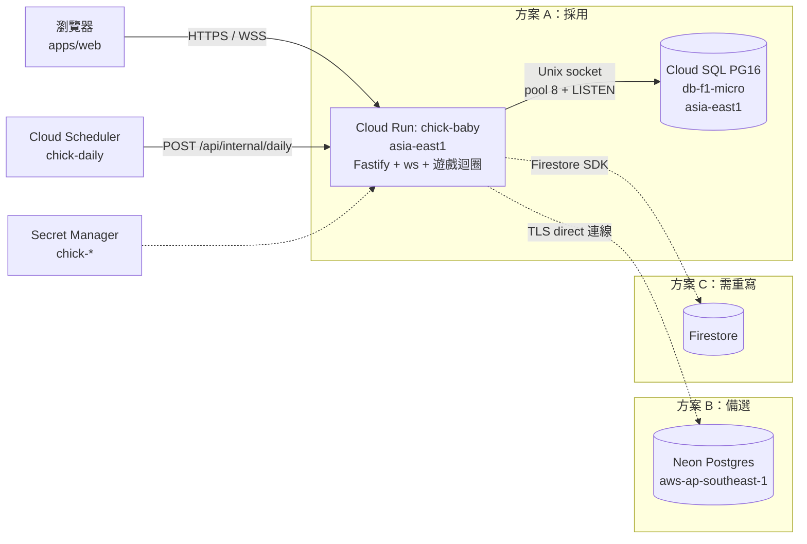

# 小雞寶寶 GCP 部署計畫書

> 日期：2026-10-13 初稿，2026-10-14 定案　｜　對象：Benson（詠玄）　｜　狀態：**已選定方案 A，尚未執行任何建立資源的動作**
> 範圍：M1（`apps/web` + `apps/server` + `packages/engine`）部署到 GCP 專案 `silver-greens`（編號 704427759894，**個人帳號 `spigflying@gmail.com`**）。
> 相關文件：[`requirements.md`](requirements.md)、[`DEPLOY.md`](DEPLOY.md)（方案 A 逐步指令）。
> **所有金額都是估算**，以 USD、每月 730 小時計，依 2026-10-13～14 查到的官方牌價；台幣以 1 USD = 32.14 TWD 換算（2026-10-14）。實際費用以 Billing 報表為準。

---

## 0. 結論

**採用 A 方案 —— Cloud Run（instance-based billing、`min-instances=0`、`max-instances=2`）+ Cloud SQL for PostgreSQL `db-f1-micro`，兩者都在台灣 `asia-east1`。**

- 程式碼不需要改資料層（標準 Postgres：transaction、`FOR UPDATE`、`LISTEN/NOTIFY`）。
- **預估每月**（細節見 §3）：

  | 使用情境 | 未扣免費額度 | **扣 Cloud Run 免費額度後** |
  |---|---|---|
  | 低：150 小時/月（上班時段才開分頁，且有隱藏分頁斷線） | ~$20.7（NT$670） | **~$15.5（NT$500）** |
  | 中：300 小時/月 | ~$31.5（NT$1,010） | ~$25.4（NT$820） |
  | 高：730 小時/月（有人 24 小時開著分頁） | ~$61.9（NT$1,990） | ~$54.8（NT$1,760） |

  2026-10-14 查過：帳單帳戶上現有的 Cloud Run 服務都是 request-based 計費、用量不到免費額度的 1%，instance-based 的免費額度（240,000 vCPU-s + 450,000 GiB-s ≈ $5.2/月）可以全部給本服務用（§1）。
- **部署前必須完成的程式改動**（另開 PR）：
  1. 前端在分頁隱藏或閒置時斷開 WebSocket（§6.1）——這比選哪個資料庫更影響帳單。
  2. 連線池 `max: 10` → `8`（`apps/server/src/db.ts:13`），配合 f1-micro 的 25 條連線上限（§6.5）。
- **為什麼選 A 而不是 B（Neon，省 ~NT$170–240/月）**：
  - 遊戲要能正常玩：Neon Free 只要 CU-hours 或對外傳輸超過額度，**整個月剩下的時間都會停機**；A 沒有這個風險。
  - 玩家在台灣：A 的「玩家 ↔ 伺服器」與「伺服器 ↔ DB」都在台灣，延遲最低。B 要嘛玩家連新加坡，要嘛 DB 往返多 35–50ms（§4.2）。
  - Neon 每 5 分鐘無查詢就會關掉 LISTEN 連線，造成廣播短暫空窗（§2.8）；Cloud SQL 沒有這個問題。
  - 使用量一高，A 反而比 B 便宜（高情境 A ~NT$1,990 vs B ~NT$2,640）。
  - 資料留在 GCP 台灣，帳號與帳單只有一處。

## 1. 現況（2026-10-13 已確認）

| 項目 | 狀態 |
|---|---|
| 帳單 | 已啟用；**實際花費未知**，要看 Billing 報表（§8） |
| Cloud Run | `silver-greens`（asia-east1，minScale 0、maxScale 20）、`vote-lab`（asia-east1，minScale 0、maxScale 5）——**本計畫完全不碰** |
| Cloud SQL | 沒有（`sqladmin.googleapis.com` 未啟用） |
| 免費額度用量（2026-10-14 用 Cloud Monitoring 查） | 帳號可見的個人專案中，Cloud Run 只有 `silver-greens`、`vote-lab`（`silver-greens`）與 `ig-info-collector`（`mela-501310`），全部是 **request-based**、1 vCPU / 512 MiB。`billable_instance_time` 9/3–9/30 合計約 1,822 秒、10/1–10/14 約 870 秒（`ig-info-collector` 無資料），不到 request-based 免費額度 180,000 vCPU-s 的 1%；**instance-based 免費額度沒被使用**。Cloud Scheduler 現有 0 個 job（每帳單帳戶 3 個免費）；Artifact Registry 已用約 380 MB（免費 0.5 GB）。帳單帳戶的專案清單與幣別因 Cloud Billing API 未啟用而未查到 |
| 已啟用 | Firestore、BigQuery、Pub/Sub、Secret Manager、Artifact Registry |
| 規模假設 | ≤ 200 使用者、尖峰同時在線約 50 人、上班時段為主 |
| 應用程式特性 | 一個容器同時提供 REST + WebSocket + 靜態前端；用 transaction 與 `FOR UPDATE`（依 id 排序上鎖）；一條專用連線跑 `LISTEN chick` 做跨執行個體廣播（斷線 1 秒後自動重連，`apps/server/src/bus.ts`）；每日排程清除 IP；pg 連線池 `max: 10`（要改成 8） |
| 前端 WebSocket | 約 50 分鐘主動重連一次、斷線指數退避重連；**沒有處理分頁隱藏**（`apps/web/src/ws.ts`） |

## 2. 計費關鍵事實（查證過的）

1. **Cloud SQL 依執行時數收費，不看使用量**：「Instance pricing is charged for every second that the instance is running」。shared-core 不在 SLA 內，也不能用 CUD。[1]
   - 官方價格頁 asia-east1：`db-f1-micro` **$0.0105/小時（$7.665/月）**；asia-southeast1 為 $0.0147/小時。
   - SSD 儲存 asia-east1：**zonal $0.17/GB-月**；HA（regional）$0.34/GB-月。本案用 zonal。（初稿誤用 HA 價格，已更正。）
2. **Cloud Run 上，開著的 WebSocket 就等於在計費**：「A Cloud Run instance that has any open WebSocket connection is considered active, so CPU is allocated and the service is billed as instance-based billing.」[4]
   - 所以只要有人開著分頁，執行個體就一直在算錢。電子雞的使用方式剛好是「開著分頁放著」，這是本案最大的成本風險。
3. **兩種計費方式**（官方價格頁，Tier 1）：

   | 方式 | CPU 費率 | 說明 |
   |---|---|---|
   | Instance-based | $0.000018/vCPU-s、$0.000002/GiB-s | 整個執行個體存活期間都收費，但費率較低、背景 CPU 不被節流 [2][3] |
   | Request-based | $0.000024/vCPU-s、$0.0000025/GiB-s，另加 $0.40/百萬請求 | 只在處理請求時收費 [2] |

   因為 WebSocket 連線本身就算「處理中的請求」，本案用 request-based 省不到錢，反而費率較高。**選 instance-based**。
4. **`min-instances=0` 時，instance-based 仍然會縮到 0**：「An instance will never stay idle for more than 15 minutes after processing a request unless it is kept active using minimum instances.」[3] 所以沒人連線時，最多再收 15 分鐘就停。
5. **Cloud Run 免費額度**：instance-based 每月 240,000 vCPU-s + 450,000 GiB-s（約 $5.2），「aggregated across projects by billing account」。官方價格頁把 instance-based 與 request-based（180,000 vCPU-s + 360,000 GiB-s + 200 萬請求）的免費額度分開列；現有服務都是 request-based 且用量極小（§1），所以本服務可用滿 instance-based 的額度。§3 的表格**不扣免費額度**（保守），扣除後的數字見 §0。[2]
6. **區域價差**（官方價格頁）：asia-east1（台灣）是 Tier 1；asia-southeast1（新加坡）是 Tier 2，instance-based 為 $0.0000216/vCPU-s、$0.0000024/GiB-s（約貴 20%）。[2]
7. **max instances 可能被短暫超過**：「this maximum setting can be exceeded for a brief period due to circumstances such as traffic spikes」。[5] 這和 requirements v1.1 的「正確性不依賴單一執行個體」一致，但連線數要留餘裕（§6.5）。
8. **Neon**（B 方案，僅供比較）：
   - Free：每個專案 100 CU-hours/月、1 GB 儲存、5 GB 對外傳輸、6 小時還原歷史；閒置 5 分鐘自動暫停，**不能關掉**。「Running out of CU-hours **or egress (5 GB)** suspends compute until the next billing period.」[6]
   - Launch：$0.106/CU-hour、$0.35/GB-月、即時還原 $0.20/GB-月，沒有月最低消費。[6]
   - 「no active queries for 5 minutes」就暫停，暫停時**關閉所有連線**，LISTEN 訂閱也會消失；閒置連線不算活動。[15] 本專案的 LISTEN 連線 1 秒後會重連並喚醒 Neon，所以 Cloud Run 開著時 Neon 約每 5 分鐘斷一次，期間的廣播會遺失。
   - 只有 AWS 區域；亞洲最近的是新加坡 `aws-ap-southeast-1`。[7]
   - 連線池（`-pooler`）不支援 `LISTEN/NOTIFY` 與 session-level advisory lock，必須用 direct 連線。[9]
9. **Supabase**：Free 閒置 1 週會暫停、沒有備份；Pro $25/月起。[10]
10. **Firestore**：Standard 版每天免費 50,000 讀 / 20,000 寫 / 1 GiB，只適用 default 資料庫。[13]
11. **Cloud Run spend cap 會停掉整個專案的 Cloud Run**：達到 spend cap 時「pauses all Cloud Run workloads」[3]，會連 `silver-greens`、`vote-lab` 一起停。**本計畫只用預算提醒，不設 spend cap**（§8）。
12. Cloud SQL 約 0.6 GB 記憶體這一級（`db-f1-micro`）預設 `max_connections = 25`。[14]

## 3. 方案比較

### 架構圖

### 費用估算（每月）

**假設**：
- Cloud Run 為 1 vCPU / 512 MiB、instance-based、`min=0`、`max=2`；Tier 1 每小時 $0.0684，Tier 2 每小時 $0.0821。
- 「開機時數」= 至少有一條 WebSocket 連線的時數，再加上每段閒置最多 15 分鐘的尾巴。
- Neon 用 0.25 CU，開機時數 ≈ Cloud Run 開機時數（LISTEN 重連會一直喚醒它）。
- 不扣 Cloud Run 免費額度；不含稅。

| 情境 | 低：150 小時/月 | 中：300 小時/月 | 高：730 小時/月 |
|---|---|---|---|
| Cloud Run asia-east1（Tier 1） | $10.3 | $20.5 | $49.9 |
| Cloud Run asia-southeast1（Tier 2） | $12.3 | $24.6 | $59.9 |
| **A** Cloud SQL f1-micro + 10 GB zonal SSD + 備份 | $9.5（固定） | $9.5 | $9.5 |
| **B** Neon Free | $0 | $0 | **超過 100 CU-h → 月中停機**，必須用 Launch（~$19.7） |
| **C** Firestore | ~$0–3 | ~$0–3 | ~$0–3 |
| 其他（Artifact Registry、Secret Manager、Scheduler、對外流量） | ~$1 | ~$1.5 | ~$2.5 |
| **合計 A**（全部台灣，**採用**） | **$20.7（NT$670）** | **$31.5（NT$1,010）** | **$61.9（NT$1,990）** |
| 合計 B（新加坡 + Neon；高情境用 Launch） | $13.3（NT$430） | $26.1（NT$840） | $82.1（NT$2,640） |
| 合計 B'（Cloud Run 台灣 + Neon 新加坡） | $11.3（NT$360） | $22.0（NT$710） | $72.1（NT$2,320） |
| 合計 C（台灣，**另加重寫工時**） | $11–14（NT$360–460） | $22–25（NT$710–800） | $52–55（NT$1,690–1,780） |

估算細節：
- **Cloud SQL**：$0.0105 × 730 = $7.67；SSD 10 GB × $0.17 = $1.70；備份約 1 GB ≈ $0.1 → **約 $9.5/月**。[1]
- **Firestore**：假設每天 6,000 次動作 × 約 6 筆寫入；用 named database 沒有免費額度時約 $2–3/月。
- **M2**（多人即時）每局約 50 KB/s × 3 分鐘 ≈ 9 MB；每天 50 局 ≈ 13.5 GB/月，Cloud Run 對外流量約 $0.12/GB → **約 $1.6/月**（估算，未計入上表）。

**看表的重點**：
- 三個方案的資料庫差價每月只有約 $0–10。
- 真正會讓帳單翻倍的是「有人 24 小時開著分頁」，所以 §6.1 的斷線機制比選哪個資料庫更重要。
- 低用量時 A 比 B 每月多約 NT$170–240；高用量時 A 反而最便宜。

### 優缺點

| | A：Cloud SQL（採用） | B：Neon | C：Firestore |
|---|---|---|---|
| 程式碼改動 | 無（pool 調成 8） | 無（用 direct 連線字串） | **重寫整個資料層** |
| 費用特性 | 固定約 $9.5/月，不管有沒有人用 | 用多少付多少；Free 額度內 $0 | 用量極小，幾乎 $0 |
| 資料位置 | GCP 台灣 | AWS 新加坡（第三方） | GCP 台灣 |
| 延遲 | 玩家、伺服器、DB 都在台灣 | 伺服器放新加坡：玩家往返多 ~35–50ms；伺服器放台灣：每次 DB 往返多 ~35–50ms（估算，未實測） | 同區 |
| 備份 | 自動備份 + PITR（7 天） | Free 只有 6 小時還原歷史 → 要自己做每晚 `pg_dump` | 備份 / PITR 另外計費 |
| SLA | shared-core **沒有** SLA | Free / Launch **沒有** SLA | 有 |
| 停機風險 | 無額度上限 | **Free 額度用完 → 月中停機** | 無 |
| 廣播 | LISTEN 連線穩定 | 每 5 分鐘無查詢就被斷，有空窗 | 要改用 Pub/Sub |
| 維運 | 在 GCP 內管理，IAM 整合 | 多一個外部帳號與帳單 | 在 GCP 內管理 |
| 主要風險 | 沒人用時也收錢；只有 25 條連線 | 停機、第三方、廣播空窗 | 重寫的工時與 bug |

### C 方案會壞掉什麼（為什麼不採用）

| 現在依賴的 Postgres 功能 | 換成 Firestore 後 |
|---|---|
| `SELECT … FOR UPDATE ORDER BY id`（依序鎖錢包與寵物） | Firestore transaction 以文件為單位，必須先讀後寫，沒有 SQL 查詢鎖；上鎖順序、重試、爭用都要重寫 |
| 部分唯一索引（每人只能有一隻存活寵物）、`share_code`、`google_sub` 唯一 | 沒有唯一約束 → 要用「哨兵文件」在 transaction 內模擬 |
| `SUM` 計算訪客每日餵食次數、ledger 對帳、管理頁 join | 沒有 join / 任意聚合 → 要反正規化成計數器文件 |
| `LISTEN/NOTIFY` 跨執行個體廣播（在 commit 後才送出） | 改用 Pub/Sub 或伺服器端 `onSnapshot`；「commit 之後才廣播」的保證要自己做 |
| Kysely migration、`kysely_migration_lock` | 沒有 schema；資料格式要在程式內做版本管理 |
| 每日 IP 清空（`UPDATE … SET ip = NULL`） | TTL 只能刪整份文件 → 要寫批次工作 |
| 本機測試用 Postgres | 改用 Firestore emulator；所有整合測試都要重寫 |

估計要 1–2 週重寫加測試（粗估）。每月最多省約 $10，不划算。

### Supabase（附帶評估）
Free 版閒置 1 週會暫停、沒有備份；Pro 版 $25/月起，比 Cloud SQL 貴。**不採用**。

## 4. 方案細節

### 4.1 A（採用）

| 項目 | 設定 |
|---|---|
| 區域 | 全部 `asia-east1` |
| Cloud Run | `--no-cpu-throttling`（instance-based）、`--min-instances=0`、`--max-instances=2`、`--cpu=1 --memory=512Mi`、`--concurrency=1000`、`--timeout=3600`、`--session-affinity`、`--labels=app=chick-baby` |
| Cloud SQL | `chick-db`：PostgreSQL 16、`--edition=ENTERPRISE`（shared-core 只有 Enterprise 版能用）、`db-f1-micro`、10 GB SSD + 自動擴充、zonal、自動備份保留 7 份 + PITR 7 天 |
| DB 連線 | Cloud Run 內建 Cloud SQL Unix socket（`--add-cloudsql-instances`），不開公開 IP 授權網路；連線池 `max: 8` × 2 個執行個體 + 2 條 LISTEN = 18 條，低於 25 |
| 備份 | Cloud SQL 自動備份（每天，台北 02:00）+ PITR；不需要另外的備份 Job |
| 每日排程 | Cloud Scheduler `chick-daily`，00:10（台北），清除 IP / 冪等紀錄 / 過期 session |

逐步指令見 [`DEPLOY.md`](DEPLOY.md)。

### 4.2 B / B'（備選，觸發條件見 §10）
- B：Cloud Run 與 Neon 都放新加坡。玩家在台灣，每次 API／WebSocket 往返多約 35–50ms（估算）。
- B'：Cloud Run 留台灣、Neon 在新加坡。一次餵食 transaction 大約 8–12 次 DB 往返，會變成 0.3–0.6 秒，**超過 requirements 的 p95 < 300ms 目標**。
- 若改走 B，還要處理：
  - LISTEN 每 5 分鐘被斷造成的廣播空窗（例如重連後讓前端重新同步）；
  - Neon 對外傳輸 5 GB 上限的監控；
  - 每晚 `pg_dump` 到 GCS（官方 `postgres` 映像沒有 `gcloud`／`gsutil`，要用 Cloud Run Jobs 的 Cloud Storage volume mount 或自製映像）。

## 5. 新資源命名（不動既有的 `silver-greens`、`vote-lab`）

所有資源都加標籤 `app=chick-baby`，方便在 Billing 報表中篩選（Cloud SQL 的標籤在 Console 加；本機 gcloud 578.0.0 的 `sql instances create` 沒有 `--labels`）。

| 類型 | 名稱 |
|---|---|
| Cloud Run 服務 | `chick-baby`（網址預計為 `https://chick-baby-704427759894.asia-east1.run.app`，以 `gcloud run services describe` 為準） |
| Cloud SQL | instance `chick-db`、database `chick`、user `chick` |
| 服務帳號 | `chick-run@silver-greens.iam.gserviceaccount.com` |
| Artifact Registry | `asia-east1-docker.pkg.dev/silver-greens/chick/server` |
| Cloud Scheduler | `chick-daily` |
| Secret Manager | 見 §7 |
| 預算 | `chick-baby-monthly` |

## 6. 風險與對策

### 6.1 WebSocket 讓執行個體一直開著（成本最大的風險）
- 現況：前端沒有處理「分頁隱藏」；客戶端約 50 分鐘重連一次，所以只要有一個分頁開著，執行個體就 24 小時存活，帳單會落在「高」情境（~NT$1,990/月）。
- **對策（部署前要先改程式，這份文件不含這部分程式碼）**：
  - 分頁 `visibilitychange` 變成 hidden 超過 2 分鐘，或使用者 10 分鐘沒有操作 → 主動關閉 WebSocket。
  - **實作注意**：`Live` 的 `onclose` 在 `stopped` 不是 true 時會自動重連，所以要呼叫 `stop()`（或另加暫停旗標），只呼叫 `ws.close()` 會馬上連回去。
  - 重新顯示或有操作時再連回來，並重新同步狀態。
  - 比賽中不斷線。
  - 寵物狀態本來就是存取時才結算，斷線不影響遊戲正確性。
- 部署後兩週觀察 Cloud Run 的 `billable_instance_time`，確認落在低或中情境。

### 6.2 冷啟動
- `min-instances=0` 時，第一個人進來要等 Node 啟動並跑完 migration 檢查，估計 1–2 秒。Cloud SQL 一直開著，沒有 DB 喚醒延遲。
- 前端顯示「連線中…」。要消除冷啟動就得設 `min=1`，每月會多約 $40–50（~NT$1,300–1,600），不建議。

### 6.3 Cloud SQL 的風險
- **沒人用也收錢**：固定約 $9.5（~NT$305）/月。
- **shared-core 沒有 SLA**：Google 維護時可能短暫斷線；LISTEN 連線會自動重連，連線池會建新連線。
- **刪除 instance 會一起刪掉自動備份**：撤回計畫前要先 `gcloud sql export sql` 到 GCS 留一份。

### 6.4 資料位置與隱私
- 資料（Google `sub`、email、顯示名稱、30 天內的 IP、遊戲資料）全部在 GCP `asia-east1`（台灣）。

### 6.5 其他
- **連線數**：f1-micro 只有 25 條連線。`max-instances=2` × pool 8 + 2 條 LISTEN = 18，換版時新舊 revision 短暫並存、手動 `psql`／匯出也還有餘裕。**不要把 max-instances 調高**；要調高就同時調低 pool。
- **部署與重啟**：會送 SIGTERM，進行中的下樓梯會中止（requirements 已定義）。盡量在離峰時部署。
- **OAuth 同意畫面是整個專案共用一個**：在 `silver-greens` 設定品牌名稱，會影響同專案其他使用 Google 登入的服務（如果 `silver-greens` 或 `vote-lab` 有用的話）。要先確認。
- **cron secret**：用 `--headers` 傳給 Scheduler 時，會以明碼存在 job 設定裡，有 Scheduler 檢視權限的人都看得到。個人專案可以接受；之後可以改成 OIDC token 驗證。
- **帳號**：本機 gcloud 預設可能是公司帳號；所有指令都要在 `spigflying@gmail.com` 的 configuration 下執行（DEPLOY.md §0）。

## 7. Secrets 與設定

| 名稱 | 內容 | 誰可以讀 |
|---|---|---|
| `chick-database-url` | `postgres://chick:…@/chick?host=/cloudsql/silver-greens:asia-east1:chick-db` | `chick-run` |
| `chick-cron-secret` | 隨機 48 字元，Scheduler 呼叫內部端點時用 | `chick-run`（Scheduler 建立 job 時讀取一次） |
| `chick-admin-emails` | 管理員 email（逗號分隔） | `chick-run` |
| 環境變數（不是機密） | `NODE_ENV=production`、`GOOGLE_CLIENT_ID`、`PUBLIC_ORIGIN` | — |

- 每個 secret 只授予 `chick-run` `roles/secretmanager.secretAccessor`，不給專案層級權限。
- Secret Manager 前 6 個有效版本免費（之後每版本每月 $0.06）。

## 8. 預算與花費監控

1. **先看實際花費**：Billing → Reports，依「專案 = silver-greens」、依服務 / SKU 分組，看過去 3 個月。
   - Cloud Run 免費額度已用 Monitoring 確認幾乎沒用到（§1）；這一步主要是確認帳單幣別與其他服務的花費。
   - 建議開啟 Billing export 到 BigQuery，之後可以用 `labels.app = chick-baby` 篩選。
2. **建立預算 `chick-baby-monthly`**（指令見 DEPLOY.md §11）：
   - 範圍：專案 `silver-greens`
   - 金額：**$40/月（約 NT$1,290）**＝中情境 + 緩衝；帳單幣別若是 TWD，就設 NT$1,300。
   - 提醒：50%（≈ 低情境）、90%、100% 實際花費 + 100% 預測花費，寄給 Benson。
3. **不要設 Cloud Run spend cap**：它會暫停整個專案的 Cloud Run，包含 `silver-greens`、`vote-lab`。[3]
4. 上線兩週後檢查 Cloud Run `billable_instance_time`，回頭修正本文件的估算。

## 9. 執行步驟

> 下列步驟需要 `spigflying@gmail.com` 的 GCP 權限。每一步都是**新增**資源，不修改既有服務。

**Phase 0：前置**
1. ~~確認方案~~ → 已選 A（2026-10-14）。
2. 看 Billing 報表（§8-1），建立預算 `chick-baby-monthly`。
3. 程式改動（另外開 PR）：分頁隱藏 / 閒置時斷開 WS（§6.1）、冷啟動時顯示「連線中」、連線池改成 `max: 8`。

**Phase 1：Google OAuth（在 Console 操作，gcloud 做不到）**
1. Console → **Google Auth Platform**（舊名 OAuth consent screen）→ Branding：App name「小雞寶寶」、support email。若專案已經有其他 app 的設定，先確認名稱共用沒問題。
2. Audience：**External**，按 **Publish app**（In production）。只用 `openid`、`userinfo.email`、`userinfo.profile` 這些非敏感 scope，不需要審查；上傳 logo 可能需要品牌驗證，建議先不要上傳。
3. Clients → Create client → **Web application**，名稱 `chick-baby-web`。
   - Authorized JavaScript origins：`https://chick-baby-704427759894.asia-east1.run.app`（部署後以實際網址為準），本機測試可加 `http://localhost:5173`。
   - 不需要 redirect URI（用 ID token 流程）。
4. 記下 Client ID（不是機密）。

**Phase 2：GCP 資源（照 DEPLOY.md §0–§8）**
1. 建立 gcloud configuration（帳號 `spigflying@gmail.com`、專案 `silver-greens`、區域 `asia-east1`）。
2. 啟用 API（含 `sqladmin`）。
3. 建立服務帳號 `chick-run`。
4. 建立 Cloud SQL `chick-db`、database、user；在 Console 加標籤 `app=chick-baby`。
5. 建立 secrets 並逐一授權。
6. 建立 Artifact Registry `chick`，`gcloud builds submit` 建置映像。
7. `gcloud run deploy chick-baby`（參數如 §4.1）；啟動時會自動執行 migration。
8. 把實際網址更新到 `PUBLIC_ORIGIN` 與 OAuth origins。
9. 建立 Scheduler `chick-daily`。

**Phase 3：驗證**
1. `curl $URL/healthz`、`$URL/api/config`。
2. Google 登入；用管理員帳號確認「管理」頁。
3. 用兩個帳號測試：拜訪、餵食、每日上限、即時廣播（確認 `LISTEN` 有收到通知）、單人下樓梯。
4. `gcloud sql backups list --instance=chick-db` 確認有自動備份。
5. 量測餵食 API 的 p95 延遲（目標 < 300ms）。
6. 關掉所有分頁 20 分鐘後，確認 Cloud Run 執行個體縮到 0（費用模型的前提）。

**Phase 4：上線後**：兩週後檢查費用（§8-4）。

## 10. 回滾與切換

| 情境 | 作法 |
|---|---|
| 新版本有問題 | `gcloud run services update-traffic chick-baby --to-revisions=<上一版>=100`。Migration 只會往前，所以新版 migration 要保持向下相容（只新增欄位/表）；破壞性變更要先備份 |
| 資料被改壞 | Cloud SQL PITR（7 天內任一時間點，會還原成新 instance）或從自動備份還原 |
| 想省 DB 固定費 → B | 若兩週觀察後確定長期落在低情境，且接受 §4.2 的延遲與停機風險：1）建 Neon（新加坡）；2）短暫停止服務；3）`pg_dump -Fc` → `pg_restore` 到 Neon；4）更新 `chick-database-url`（direct 連線，不要用 `-pooler`）、拿掉 `--add-cloudsql-instances` 重新部署；5）驗證後 export 一份再刪除 `chick-db`。預估停機 10–30 分鐘 |
| 整個計畫撤回 | 先 `gcloud sql export sql` 留一份資料，再刪除 `chick-baby` 服務、Scheduler job、secrets、Artifact Registry `chick`、Cloud SQL `chick-db`、服務帳號。`silver-greens`、`vote-lab` 與 GitHub Pages 原型都不受影響 |

## 11. 待確認

1. ~~方案~~ → A。~~區域~~ → asia-east1。
2. 預算 $40/月（~NT$1,290）可以嗎？提醒寄給誰？帳單幣別是 USD 還是 TWD？
3. `silver-greens` 專案的 OAuth 同意畫面是否已被其他服務使用（品牌名稱共用）？

## 12. 資料來源（2026-10-13～14 查詢）

1. Cloud SQL pricing（各區單價取自官方頁面資料）— https://cloud.google.com/sql/pricing
2. Cloud Run pricing（Tier 1/2 區域表、各區單價、免費額度）— https://cloud.google.com/run/pricing
3. Cloud Run billing settings（instance-based、15 分鐘閒置、spend cap）— https://cloud.google.com/run/docs/configuring/billing-settings
4. Cloud Run WebSockets（timeout、session affinity、計費）— https://cloud.google.com/run/docs/triggering/websockets
5. Cloud Run maximum instances — https://cloud.google.com/run/docs/configuring/max-instances
6. Neon pricing — https://neon.com/pricing
7. Neon regions — https://neon.com/docs/introduction/regions
8. Neon scale to zero — https://neon.com/docs/introduction/scale-to-zero
9. Neon connection pooling（pooled 連線不支援 LISTEN/NOTIFY）— https://neon.com/docs/connect/connection-pooling
10. Supabase pricing — https://supabase.com/pricing
11. （第三方）Bytebase：Cloud SQL db-f1-micro 各區月費 — https://www.bytebase.com/dbcost/cloudsql/instance/db-f1-micro/
12. 官方降低成本建議 — https://docs.cloud.google.com/run/docs/tips/services-cost-optimization
13. Firestore pricing — https://cloud.google.com/firestore/pricing
14. Cloud SQL for PostgreSQL flags（`max_connections` 預設值）— https://docs.cloud.google.com/sql/docs/postgres/flags
15. Neon compute lifecycle（無查詢 5 分鐘暫停、暫停時關閉連線與 LISTEN）— https://neon.com/docs/introduction/compute-lifecycle
16. 匯率 USD/TWD 32.14（2026-10-14）— https://open.er-api.com/v6/latest/USD
