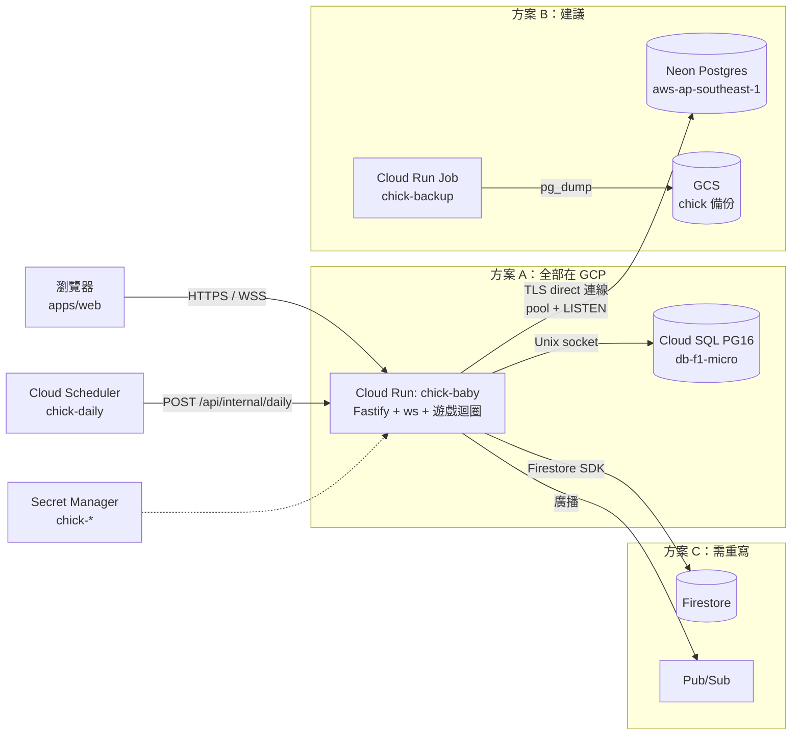

# 小雞寶寶 GCP 部署計畫書（審閱用草案）

> 日期：2026-10-13　｜　對象：Benson（詠玄）　｜　狀態：**待審閱，尚未執行任何建立資源的動作**
> 範圍：M1（`apps/web` + `apps/server` + `packages/engine`）部署到 GCP 專案 `silver-greens`（編號 704427759894）。
> 相關文件：[`requirements.md`](requirements.md)、[`DEPLOY.md`](DEPLOY.md)（Cloud SQL 版逐步指令）。
> **所有金額都是估算**，以 USD、每月 730 小時計，依 2026-10-13 查到的公開牌價；實際費用以 Billing 報表為準。

---

## 0. 結論先講

**建議：B 方案 —— Cloud Run（instance-based billing、`min-instances=0`）+ Neon Postgres Free（`aws-ap-southeast-1` 新加坡）。Cloud Run 也放在新加坡 `asia-southeast1`，跟資料庫同城。**

- 程式碼不需要改資料層，仍是標準 Postgres（transaction、`FOR UPDATE`、`LISTEN/NOTIFY` 都能用）。
- 前提條件：
  1. 前端加上「分頁隱藏或閒置就斷開 WebSocket」（§6.1）。
  2. Neon 一律用 **direct 連線**（不要用 `-pooler`）。
  3. 每晚 `pg_dump` 備份到 GCS。
- 費用：資料庫 $0（在 Free 額度內）。實際上**最大的變數是 Cloud Run 開著的時數，不是資料庫**。
- 遇到以下情況就改走 A（Cloud SQL）或升級 Neon Launch，搬遷只需要 `pg_dump` / `pg_restore` 加上換 secret（§10）：
  - 公司要求資料留在 GCP / 台灣
  - Neon 每月用量超過 80%
  - 使用變成接近 24 小時都開著
- **價格反而指出的一點**：如果服務 24 小時都開著，Cloud SQL `db-f1-micro`（約 $0.0105/小時）比 Neon Launch 0.25 CU（$0.0265/小時）**便宜**。Neon 只有在每月實際開機時數低（約 < 400 小時，Free 額度內）時才划算。

## 1. 現況（2026-10-13 已確認）

| 項目 | 狀態 |
|---|---|
| 帳單 | 已啟用；**實際花費未知**，要看 Billing 報表（§8） |
| Cloud Run | `silver-greens`（asia-east1，minScale 0、maxScale 20）、`vote-lab`（asia-east1，minScale 0、maxScale 5）——**本計畫完全不碰** |
| Cloud SQL | 沒有（`sqladmin.googleapis.com` 未啟用） |
| 已啟用 | Firestore、BigQuery、Pub/Sub、Secret Manager、Artifact Registry |
| 規模假設 | ≤ 200 使用者、尖峰同時在線約 50 人、上班時段為主 |
| 應用程式特性 | 一個容器同時提供 REST + WebSocket + 靜態前端；用 transaction 與 `FOR UPDATE`（依 id 排序上鎖）；一條專用連線跑 `LISTEN chick` 做跨執行個體廣播；每日排程清除 IP；pg 連線池 `max: 10` |

## 2. 計費關鍵事實（查證過的）

1. **Cloud SQL 依執行時數收費，不看使用量**：「Instance pricing is charged for every second that the instance is running」。`db-f1-micro` 為 $0.0105/小時，`db-g1-small` 為 $0.035/小時；shared-core 不在 SLA 內，也不能用 CUD。[1]
   - 第三方整理的各區價格中，asia-east1 的 f1-micro 約 $8/月，屬於最便宜的那一級。[11]
2. **Cloud Run 上，開著的 WebSocket 就等於在計費**：「A Cloud Run instance that has any open WebSocket connection is considered active, so CPU is allocated and the service is billed as instance-based billing.」[4]
   - 所以只要有人開著分頁，執行個體就一直在算錢。電子雞的使用方式剛好是「開著分頁放著」，這是本案最大的成本風險。
3. **兩種計費方式**：

   | 方式 | CPU 費率（Tier 1，如 asia-east1） | 說明 |
   |---|---|---|
   | Instance-based | $0.000018/vCPU-s、$0.000002/GiB-s | 整個執行個體存活期間都收費，但費率較低、背景 CPU 不被節流 [2][3] |
   | Request-based | $0.000024/vCPU-s、$0.0000025/GiB-s，另加 $0.40/百萬請求 | 只在處理請求時收費 [2] |

   因為 WebSocket 連線本身就算「處理中的請求」，本案用 request-based 省不到錢，反而費率較高。**選 instance-based**。
4. **`min-instances=0` 時，instance-based 仍然會縮到 0**：「An instance will never stay idle for more than 15 minutes after processing a request unless it is kept active using minimum instances.」[3] 所以沒人連線時，最多再收 15 分鐘就停。
5. **Cloud Run 免費額度**：instance-based 每月 240,000 vCPU-s + 450,000 GiB-s（約 $5.2）。這是**整個帳單帳戶共用**，`silver-greens`、`vote-lab` 可能已經用掉。下面估算**不扣免費額度**（保守）。[2]
6. **區域價差**：asia-east1（台灣）是 Tier 1；asia-southeast1（新加坡）是 Tier 2。第三方整理的 Tier 2 instance-based 價格約為 $0.0000216/vCPU-s、$0.0000024/GiB-s（約貴 20%），**需要用官方計算機確認**。[2][12]
7. **max instances 可能被短暫超過**：「this maximum setting can be exceeded for a brief period due to circumstances such as traffic spikes」。[5] 這和 requirements v1.1 的「正確性不依賴單一執行個體」一致。
8. **Neon**：
   - Free：每個專案 100 CU-hours/月、1 GB 儲存、5 GB 對外傳輸、6 小時還原歷史；閒置 5 分鐘自動暫停，**不能關掉**。**CU-hours 用完時，運算會被暫停到下個月**。
   - Launch：$0.106/CU-hour、$0.35/GB-月、即時還原 $0.20/GB-月，沒有月最低消費。[6]
   - 喚醒「within a few hundred milliseconds」。[8]
   - 只有 AWS 區域；亞洲最近的是**新加坡 `aws-ap-southeast-1`**（沒有台灣、東京）。[7]
   - 連線池（`-pooler`，PgBouncer transaction mode）**不支援 `LISTEN/NOTIFY` 與 session-level advisory lock**，必須用 direct 連線。[9]
9. **Supabase**：
   - Free：500 MB，**閒置 1 週會暫停**，沒有備份，最多 2 個專案。
   - Pro：$25/月起（含 Micro 運算）；PITR 另加 $100/月。[10]
10. **Firestore**：
    - Standard 版：每天免費 50,000 讀 / 20,000 寫 / 1 GiB；超過後讀 $0.03、寫 $0.09（每 10 萬筆，Iowa 價格；asia-east1 可能略高）。[13]
    - 免費額度只適用專案的 **default 資料庫**；另建的 named database 沒有免費額度。
11. **Cloud Run spend cap 會停掉整個專案的 Cloud Run**：達到 spend cap 時「pauses all Cloud Run workloads」[3]，會連 `silver-greens`、`vote-lab` 一起停。**本計畫只用預算提醒，不設 spend cap**（§8）。
12. Cloud SQL `db-f1-micro`（約 0.6 GB）預設 `max_connections = 25`。[14]

## 3. 方案比較

### 架構圖

### 費用估算（每月，USD）

**假設**：
- Cloud Run 為 1 vCPU / 512 MiB、instance-based、`min=0`、`max=2`。
- 「開機時數」= 至少有一條 WebSocket 連線的時數，再加上每段閒置最多 15 分鐘的尾巴。
- Neon 用 0.25 CU（autoscaling 上限設 0.25–0.5），開機時數 ≈ Cloud Run 開機時數 + 每段 5 分鐘。
- 不扣 Cloud Run 免費額度；不含稅。

| 情境 | 低：150 小時/月（只有上班時開分頁，且有隱藏分頁斷線） | 中：300 小時/月 | 高：730 小時/月（有人 24 小時開著分頁） |
|---|---|---|---|
| Cloud Run asia-east1（Tier 1，$0.068/小時） | $10.3 | $20.5 | $49.9 |
| Cloud Run asia-southeast1（Tier 2，約 $0.082/小時，估算） | ~$12.3 | ~$24.6 | ~$59.9 |
| **A** Cloud SQL f1-micro + 10 GB SSD + 備份 | $11.2（固定） | $11.2 | $11.2 |
| **B** Neon Free | $0（37.5 CU-h） | $0（75 CU-h） | **超過 100 CU-h → 月中暫停**，必須用 Launch |
| **B** Neon Launch | ~$4.5 | ~$8.5 | ~$20 |
| **C** Firestore | ~$0–3（流量估算，見下） | ~$0–3 | ~$0–3 |
| 其他（Artifact Registry、Secret Manager、Scheduler、GCS 備份、對外流量） | ~$1 | ~$1–2 | ~$2–3 |
| **合計 A**（asia-east1） | **~$22** | **~$33** | **~$62** |
| **合計 B**（新加坡，Neon Free；高情境用 Launch） | **~$13** | **~$26** | **~$82** |
| **合計 B'**（Cloud Run 台灣 + Neon 新加坡） | ~$11 | ~$22 | ~$72 |
| **合計 C**（台灣） | ~$11–14 | ~$22–25 | ~$51–54（**另加重寫工時**） |

估算細節：
- **Cloud SQL**：
  - $0.0105 × 730 = $7.67
  - SSD $0.000465753/GiB-h × 730 × 10 GB = $3.40
  - 備份約 1 GB × $0.08 = $0.08
  - 依官方頁面的預設價格表計算；asia-east1 的實際單價要在官方頁面選區域確認。[1][11]
- **Firestore**：
  - 假設每天 6,000 次動作 × 約 6 筆寫入，約 3.6 萬寫入/天。
  - 超出免費額度的部分約 $0.4/月，讀取也約 $0.5/月。
  - 若改用 named database（因為 default DB 可能被 `silver-greens` 使用），就沒有免費額度，約 $2–3/月。
- **M2**（多人即時）每局約 50 KB/s × 3 分鐘 ≈ 9 MB；每天 50 局 ≈ 13.5 GB/月。Cloud Run 對外流量約 $0.12/GB → **約 $1.6/月**（估算）。

**看表的重點**：
- 三個方案的資料庫差價每月只有約 $0–11。
- 真正會讓帳單翻倍的是「有人 24 小時開著分頁」，所以 §6.1 的斷線機制比選哪個資料庫更重要。
- 在高情境下，A 反而最便宜。

### 優缺點

| | A：Cloud SQL | B：Neon（建議） | C：Firestore |
|---|---|---|---|
| 程式碼改動 | 無 | 無（用 direct 連線字串） | **重寫整個資料層** |
| 費用特性 | 固定約 $11/月，不管有沒有人用 | 用多少付多少；Free 額度內 $0 | 用量極小，幾乎 $0 |
| 資料位置 | GCP 台灣 | AWS 新加坡（第三方） | GCP 台灣 |
| 延遲 | 同區，約 1ms | Cloud Run 也放新加坡約 1–2ms；若 Cloud Run 在台灣，每次往返約 35–50ms（估算） | 同區 |
| 備份 | 自動備份 + PITR（7 天） | Free 只有 6 小時還原歷史 → 需要自己做每晚 `pg_dump`；Launch 有 7 天 | 備份 / PITR 另外計費 |
| SLA | shared-core **沒有** SLA | Free / Launch **沒有** SLA | 有 |
| 冷啟動 | 不會（一直開著） | 喚醒約數百毫秒 | 不會 |
| 維運 | 在 GCP 內管理，IAM 整合 | 多一個外部帳號與帳單 | 在 GCP 內管理 |
| 主要風險 | 沒人用時也收錢；只有 25 條連線 | Free 用量超過會月中停機；第三方 | 重寫的工時與 bug；`LISTEN/NOTIFY` 要換掉 |

### C 方案會壞掉什麼（為什麼不建議）

| 現在依賴的 Postgres 功能 | 換成 Firestore 後 |
|---|---|
| `SELECT … FOR UPDATE ORDER BY id`（依序鎖錢包與寵物） | Firestore transaction 以文件為單位，必須先讀後寫，沒有 SQL 查詢鎖；上鎖順序、重試、爭用都要重寫 |
| 部分唯一索引（每人只能有一隻存活寵物）、`share_code`、`google_sub` 唯一 | 沒有唯一約束 → 要用「哨兵文件」（例如 `uniq/share_code/{code}`）在 transaction 內模擬 |
| `SUM` 計算訪客每日餵食次數、ledger 對帳、管理頁 join | 沒有 join / 任意聚合 → 要反正規化成計數器文件 |
| `LISTEN/NOTIFY` 跨執行個體廣播（在 commit 後才送出） | 改用 Pub/Sub（每個執行個體一個 subscription）或伺服器端 `onSnapshot`（每次變更都算讀取費）；「commit 之後才廣播」的保證要自己做 |
| Kysely migration、`kysely_migration_lock` | 沒有 schema；資料格式要在程式內做版本管理 |
| 每日 IP 清空（`UPDATE … SET ip = NULL`） | TTL 只能刪整份文件，不能清單一欄位 → 要寫批次工作 |
| 本機測試用 Postgres | 改用 Firestore emulator；所有整合測試都要重寫 |

估計要 1–2 週重寫加測試（粗估）。每月最多省約 $11，不划算。

### Supabase（附帶評估）
- Free 版閒置 1 週會暫停、沒有備份；公司內部工具碰到連假就可能被暫停。
- Pro 版 $25/月起，比 Cloud SQL 貴。
- **不採用**。

## 4. 建議方案細節（B）

| 項目 | 設定 |
|---|---|
| 區域 | Cloud Run `asia-southeast1`；Neon `aws-ap-southeast-1`；GCS 備份 `asia-southeast1` |
| Cloud Run | `--no-cpu-throttling`（instance-based）、`--min-instances=0`、`--max-instances=2`、`--cpu=1 --memory=512Mi`、`--concurrency=1000`、`--timeout=3600`、`--session-affinity` |
| DB 連線 | Neon **direct** 連線字串（主機名稱沒有 `-pooler`），`sslmode=require`；連線池 `max: 10` × 2 個執行個體 + 2 條 LISTEN，遠低於 Neon 0.25 CU 的連線上限 |
| Neon 設定 | Free 方案；autoscaling 0.25–0.5 CU；scale-to-zero 5 分鐘（Free 固定） |
| 備份 | Cloud Run Job `chick-backup`（`postgres` 官方映像，版本和 Neon 一致）每晚 03:00（台北）執行 `pg_dump -Fc` 到 `gs://silver-greens-chick-backups/`，lifecycle 保留 30 天（每月幾分錢） |
| 每日排程 | Cloud Scheduler `chick-daily`，00:10（台北），清除 IP / 冪等紀錄 / 過期 session |

要是 Benson 偏好 Cloud Run 留在台灣（B'）：比 B 每月省約 $2–10，但每次 DB 往返多 35–50ms。一次餵食 transaction 大約 8–12 次往返（粗估），會變成 0.3–0.6 秒，**超過 requirements 的 p95 < 300ms 目標**。除非之後把往返次數壓低，否則不建議。

## 5. 新資源命名（不動既有的 `silver-greens`、`vote-lab`）

所有資源都加標籤 `app=chick-baby`，方便在 Billing 報表中篩選。

| 類型 | 名稱 |
|---|---|
| Cloud Run 服務 | `chick-baby`（網址預計為 `https://chick-baby-704427759894.asia-southeast1.run.app`，以 `gcloud run services describe` 為準） |
| Cloud Run Job | `chick-backup` |
| 服務帳號 | `chick-run@silver-greens.iam.gserviceaccount.com`（服務）、`chick-backup@silver-greens.iam.gserviceaccount.com`（備份，只有 bucket 寫入權） |
| Artifact Registry | `asia-southeast1-docker.pkg.dev/silver-greens/chick/server` |
| GCS bucket | `silver-greens-chick-backups`（uniform access、禁止公開） |
| Cloud Scheduler | `chick-daily`、`chick-backup-nightly` |
| Secret Manager | 見 §7 |
| 預算 | `chick-baby-monthly` |
| Neon | Organization 自訂；Project `chick-baby`、區域 `aws-ap-southeast-1`、database `chick`、role `chick_app`、branch `main` |
| A 方案才有 | Cloud SQL instance `chick-db`（見 DEPLOY.md） |

## 6. 風險與對策

### 6.1 WebSocket 讓執行個體一直開著（成本最大的風險）
- 現況：前端沒有處理「分頁隱藏」；客戶端約 50 分鐘重連一次，所以只要有一個分頁開著，執行個體就 24 小時存活，帳單會落在「高」情境（$50–80/月）。
- **對策（部署前要先改程式，這份文件不含這部分程式碼）**：
  - 分頁 `visibilitychange` 變成 hidden 超過 2 分鐘，或使用者 10 分鐘沒有操作 → 主動關閉 WebSocket。
  - 重新顯示或有操作時再連回來，並重新同步狀態。
  - 比賽中不斷線。
  - 寵物狀態本來就是存取時才結算，斷線不影響遊戲正確性。
- 部署後兩週觀察 Cloud Run 的 `billable_instance_time`，確認落在低或中情境。

### 6.2 冷啟動
- `min-instances=0` 時，第一個人進來要等 Node 啟動，加上 Neon 喚醒，估計 1–3 秒。
- 前端顯示「連線中…」。要消除冷啟動就得設 `min=1`，但每月會多約 $50（instance-based），不建議。

### 6.3 Neon 的風險
- **Free 額度用完會月中停機**：100 CU-h ÷ 0.25 CU = 400 小時。設定用量提醒，超過 80% 就升級 Launch（不用搬資料，只是換方案）。
- 喚醒延遲約數百毫秒，只影響每段閒置後的第一個請求。
- 用到 `-pooler` 連線會讓 `LISTEN` 收不到通知，廣播會悄悄失效 → 部署檢查清單要確認連線字串。
- Free 的還原歷史只有 6 小時 → 每晚 `pg_dump` 一定要做（requirements 要求寵物永久保存）。

### 6.4 資料位置與隱私
- B 方案的資料（Google `sub`、email、顯示名稱、30 天內的 IP、遊戲資料）存放在 **AWS 新加坡的 Neon（第三方）**，不在 GCP，也不在台灣。
- **要請 Benson 確認公司政策是否允許**；不允許就走 A。

### 6.5 其他
- **連線數**：A 方案的 f1-micro 只有 25 條連線。`max-instances=2` × pool 10 + 2 條 LISTEN = 22，可以；**不要把 max-instances 調高**，或同時調低 pool。
- **DEPLOY.md 的設定**（`--min-instances=1 --no-cpu-throttling`）會讓 Cloud Run 單獨就約 $50/月（Tier 1）。該文件寫的「約 US$15–25」偏低，之後要更新 DEPLOY.md（本次只新增這份計畫書）。
- **部署與重啟**：會送 SIGTERM，進行中的下樓梯會中止（requirements 已定義）。盡量在離峰時部署。
- **OAuth 同意畫面是整個專案共用一個**：在 `silver-greens` 設定品牌名稱，會影響同專案其他使用 Google 登入的服務（如果 `silver-greens` 或 `vote-lab` 有用的話）。要先確認。

## 7. Secrets 與設定

| 名稱 | 內容 | 誰可以讀 |
|---|---|---|
| `chick-database-url` | Neon direct 連線字串 `postgres://chick_app:…@ep-xxx.ap-southeast-1.aws.neon.tech/chick?sslmode=require`（A 方案改成 Cloud SQL Unix socket 字串） | `chick-run`、`chick-backup` |
| `chick-cron-secret` | 隨機 48 字元，Scheduler 呼叫內部端點時用 | `chick-run`（Scheduler 建立 job 時讀取一次） |
| `chick-admin-emails` | 管理員 email（逗號分隔） | `chick-run` |
| 環境變數（不是機密） | `NODE_ENV=production`、`GOOGLE_CLIENT_ID`、`PUBLIC_ORIGIN` | — |

- 每個 secret 只授予需要的服務帳號 `roles/secretmanager.secretAccessor`，不給專案層級權限。
- Neon 帳號開啟 2FA；`chick_app` role 只擁有 `chick` database。
- Secret Manager 前 6 個有效版本免費（之後每版本每月 $0.06）。

## 8. 預算與花費監控

1. **先看實際花費**：Billing → Reports，依「專案 = silver-greens」、依服務 / SKU 分組，看過去 3 個月。
   - 確認 `silver-greens`、`vote-lab` 目前的花費，以及 Cloud Run 免費額度是否已經用掉。
   - 建議開啟 Billing export 到 BigQuery（已啟用），之後可以用 `labels.app = chick-baby` 篩選。
2. **建立預算 `chick-baby-monthly`**：
   - 範圍：專案 `silver-greens`（可以再加上標籤篩選）
   - 金額：**$30/月**（B 方案中情境 + 緩衝）
   - 提醒：50%、90%、100% 實際花費 + 100% 預測花費，寄給 Benson
3. **不要設 Cloud Run spend cap**：它會暫停整個專案的 Cloud Run，包含 `silver-greens`、`vote-lab`。[3]
4. Neon：Free 方案不會產生費用；在 Console 看 CU-hours 用量。升級 Launch 後開啟 spending notifications（80% / 100%）。[6]
5. 上線兩週後檢查 Cloud Run `billable_instance_time` 與 Neon CU-hours，回頭修正本文件的估算。

## 9. 執行步驟

> 下列步驟需要 Benson 的 GCP / Neon 權限。每一步都是**新增**資源，不修改既有服務。

**Phase 0：決策與前置（Benson）**
1. 確認方案（B / A）以及資料位置是否允許放在新加坡的第三方。
2. 看 Billing 報表（§8-1），建立預算 `chick-baby-monthly`。
3. 程式改動（另外開 PR）：分頁隱藏 / 閒置時斷開 WS（§6.1）、冷啟動時顯示「連線中」。

**Phase 1：Google OAuth（Benson 在 Console 操作，gcloud 做不到）**
1. Console → **Google Auth Platform**（舊名 OAuth consent screen）→ Branding：App name「小雞寶寶」、support email。若專案已經有其他 app 的設定，先確認名稱共用沒問題。
2. Audience：**External**，按 **Publish app**（In production）。只用 `openid`、`userinfo.email`、`userinfo.profile` 這些非敏感 scope，不需要審查；上傳 logo 可能需要品牌驗證，建議先不要上傳。
3. Clients → Create client → **Web application**，名稱 `chick-baby-web`。
   - Authorized JavaScript origins：`https://chick-baby-704427759894.asia-southeast1.run.app`（部署後以實際網址為準），本機測試可加 `http://localhost:5173`。
   - 不需要 redirect URI（用 ID token 流程）。
4. 把 Client ID 交給部署者（不是機密）。

**Phase 2：Neon（Benson）**
1. 註冊 Neon（Free），建立 Project `chick-baby`、區域 **AWS Asia Pacific (Singapore)**、Postgres 版本 16 或 17。
2. 建立 role `chick_app` 與 database `chick`；autoscaling 設 0.25–0.5 CU。
3. 複製 **direct** 連線字串（主機名稱沒有 `-pooler`），加上 `sslmode=require`。

**Phase 3：GCP 資源（指令細節沿用 DEPLOY.md，把區域改成 `asia-southeast1`，並略過 Cloud SQL）**
1. `gcloud services enable run cloudbuild artifactregistry secretmanager cloudscheduler iamcredentials`（B 方案**不必**啟用 `sqladmin`）。
2. 建立服務帳號 `chick-run`、`chick-backup`。
3. 建立 secrets `chick-database-url`、`chick-cron-secret`、`chick-admin-emails`，並逐一授權。
4. 建立 Artifact Registry `chick`（asia-southeast1），`gcloud builds submit` 建置映像。
5. `gcloud run deploy chick-baby`，參數如 §4，加上 `--labels=app=chick-baby`；啟動時會自動執行 migration。
6. 把實際網址更新到 `PUBLIC_ORIGIN` 與 OAuth origins。
7. 建立 Scheduler `chick-daily`。
8. 建立 bucket `silver-greens-chick-backups`（lifecycle 30 天）、Cloud Run Job `chick-backup`、Scheduler `chick-backup-nightly`。

**Phase 4：驗證**
1. `curl $URL/healthz`、`$URL/api/config`。
2. Google 登入；用管理員帳號確認「管理」頁。
3. 用兩個帳號測試：拜訪、餵食、每日上限、即時廣播（確認 `LISTEN` 有收到通知）、單人下樓梯。
4. 手動執行一次 `chick-backup`，並在本機用 `pg_restore --list` 確認備份可讀。
5. 量測餵食 API 的 p95 延遲（目標 < 300ms）。
6. 閒置 20 分鐘後確認 Cloud Run 縮到 0、Neon 暫停（費用模型的前提）。

**Phase 5：上線後**：兩週後檢查費用（§8-5）並決定是否維持 Free。

## 10. 回滾與切換

| 情境 | 作法 |
|---|---|
| 新版本有問題 | `gcloud run services update-traffic chick-baby --to-revisions=<上一版>=100`。Migration 只會往前，所以新版 migration 要保持向下相容（只新增欄位/表）；破壞性變更要先備份 |
| 資料被改壞 | Neon：6 小時內（Launch 為 7 天）用 instant restore / 從歷史建立 branch；超過時間就用 GCS 的每晚 `pg_dump` 執行 `pg_restore`。A 方案：Cloud SQL PITR / 自動備份 |
| B → A（政策或用量原因） | 1）啟用 `sqladmin`，依 DEPLOY.md 建立 `chick-db`；2）短暫停止服務（`--max-instances=0` 或維護頁）；3）`pg_dump -Fc`（Neon direct）→ `pg_restore` 到 Cloud SQL；4）更新 `chick-database-url` secret，重新部署並加上 `--add-cloudsql-instances`；5）驗證後再刪除 Neon 專案。預估停機 10–30 分鐘 |
| 整個計畫撤回 | 刪除 `chick-baby` 服務、`chick-backup` job、Scheduler jobs、secrets、Artifact Registry `chick`、bucket、服務帳號、Neon 專案。`silver-greens`、`vote-lab` 與 GitHub Pages 原型都不受影響 |

## 11. 請 Benson 決定

1. 採用 B（Neon，新加坡）嗎？還是因為資料位置、SLA 或公司政策而選 A（Cloud SQL，台灣，固定約 $11/月）？
2. Cloud Run 放新加坡（建議，延遲較低）還是台灣（便宜約 $2–10/月，但 DB 往返較慢）？
3. 預算金額 $30/月可以嗎？提醒寄給誰？
4. `silver-greens` 專案的 OAuth 同意畫面是否已被其他服務使用（品牌名稱共用）？
5. Neon 帳號用誰的名義、付款方式（升級 Launch 時需要）？

## 12. 資料來源（2026-10-13 查詢）

1. Cloud SQL pricing — https://cloud.google.com/sql/pricing
2. Cloud Run pricing — https://cloud.google.com/run/pricing
3. Cloud Run billing settings（instance-based、15 分鐘閒置、spend cap）— https://cloud.google.com/run/docs/configuring/billing-settings
4. Cloud Run WebSockets（timeout、session affinity、計費）— https://cloud.google.com/run/docs/triggering/websockets
5. Cloud Run maximum instances — https://cloud.google.com/run/docs/configuring/max-instances
6. Neon pricing — https://neon.com/pricing
7. Neon regions — https://neon.com/docs/introduction/regions
8. Neon scale to zero — https://neon.com/docs/introduction/scale-to-zero
9. Neon connection pooling（pooled 連線不支援 LISTEN/NOTIFY）— https://neon.com/docs/connect/connection-pooling
10. Supabase pricing — https://supabase.com/pricing
11. （第三方）Bytebase：Cloud SQL db-f1-micro 各區月費 — https://www.bytebase.com/dbcost/cloudsql/instance/db-f1-micro/
12. （第三方）Cloud Run Tier 2 單價整理 — https://hamy.xyz/blog/2025-04_google-cloud-run-pricing ；官方降低成本建議 — https://docs.cloud.google.com/run/docs/tips/services-cost-optimization
13. Firestore pricing — https://cloud.google.com/firestore/pricing
14. Cloud SQL for PostgreSQL flags（`max_connections` 預設值）— https://cloud.google.com/sql/docs/postgres/flags
